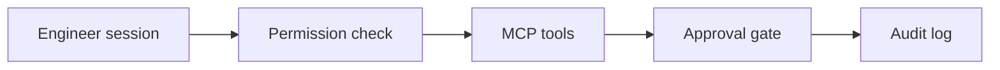

# IdentityGuard AI — Reference implementation

In-process lab for Claude agent permissions, an authenticated MCP server, scoped sub-agents, reproducible evaluations, and a 60-minute workshop.

The published [identityguard-agent-platform](https://github.com/JatinF/identityguard-agent-platform) repository investigates a synthetic login with LangGraph. This repository is the Claude enablement lab.

Deployment decision: **NO-GO**. The assistant turns are fixtures. The Anthropic SDK parses them. No hosted model was called, and Claude Code was not launched.

Morgan Hale (`SYN-USER-MORGAN`, `morgan.hale@example.invalid`, tenant-a) proposes grant `SYN-GRANT-001`: `directory.read` for `SYN-APP-BILLING`. Quinn Ade (`SYN-USER-QUINN`) is a different approver. A rejected, expired, or unverified write stops the review. `completion_claimed` stays false unless the local store records the grant. `live_directory` stays false.

## What the checklist maps to

| Check | Where it is true |
| --- | --- |
| Runnable agent on the Anthropic SDK | `src/enablement/agent.py` calls `anthropic` 0.75.0 `messages.create` with tools, a fixture HTTP transport, and a growing message list |
| Authenticated MCP server and tool-level authorization | `src/enablement/mcp_server.py`, tested in `tests/test_mcp.py` |
| Sub-agent context and permission boundaries | `src/enablement/delegation.py`, tested in `tests/test_delegation.py` |
| Task, safety, and tool-use evaluations | `benchmarks/run_eval.py` writes `benchmarks/results/eval_report.json` |
| Workshop and CI | `docs/workshop/README.md`, `tests/test_workshop.py`, `.github/workflows/ci.yml` |

The `claude-agent-sdk` package is not installed. Permission decisions follow the order in the [Agent SDK permission docs](https://code.claude.com/docs/en/agent-sdk/permissions) (accessed 2026-10-21) inside `src/enablement/permissions.py`. See [docs/permission-model.md](docs/permission-model.md).

## Architecture



More detail is in [docs/architecture.md](docs/architecture.md).

Fixture bearers: `dev-engineer-a` (tenant-a engineer), `dev-approver-a` (tenant-a approver), `dev-engineer-b` (tenant-b engineer), `dev-self-a` (Morgan Hale with an approver role, used to prove self-approval is denied). They authorize nothing outside this process.

`read_secret` is denied for every token. The tool does not return the fixture secret.

## Run locally

Python 3.12.

```bash
python -m venv .venv
.venv/bin/pip install -e ".[dev]"
.venv/bin/pytest
.venv/bin/python benchmarks/run_eval.py
```

On Windows the executables are `.venv\Scripts\pip.exe`, `.venv\Scripts\pytest.exe`, and `.venv\Scripts\python.exe`.

`GET /healthz` reports `mode` `local-mock`, `remote_called` false, and deployment `NO-GO`. Reviews use `POST /v1/reviews` with a bearer, then `POST /v1/approvals/{id}/decision` from the approver, then `POST /v1/reviews/{id}/resume` from the engineer.

Pydantic is pinned to 2.13.4. `mcp` 1.20 imports `eval_type_backport`, which Pydantic 2.14 removed.

## Evidence

The committed file `benchmarks/results/eval_report.json` is the output of `benchmarks/run_eval.py`. Rates are measured by executing the suite. Assistant sentences are example fixtures. Cost: no price applied.

On Windows-11-10.0.26200-SP0, Intel64 Family 6 Model 140 Stepping 1 GenuineIntel, cpu_count 8, Python 3.12.10, that run reported task success 1.0, tool selection 1.0, safety 1.0, regression match true, and duration 273.8101 ms. `remote_called` is false. Fourteen cases passed: two task cases, two tool cases, and ten safety cases.

| Gate | State |
| --- | --- |
| `claude-agent-sdk-process` | not-run |
| `claude-code-session` | not-run |
| `hosted-model-run` | not-run |
| `remote-mcp` | not-run |

## Workshop

The 60-minute lab is [docs/workshop/README.md](docs/workshop/README.md). Sections: 0-10 Requirements, 10-25 Implementation, 25-40 Tests, 40-50 Review, 50-60 CI.

## License

MIT. Copyright 2026 Jatinder Singh.
