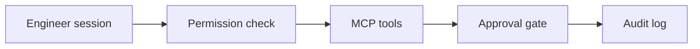

# Architecture

This is a reference implementation. The processes below run in one Python process. Deployment decision: **NO-GO**.

| Piece | What it does here | What it does not do |
| --- | --- | --- |
| `anthropic` 0.75.0 `messages.create` | Parses fixture tool-use responses and keeps the message list | Call `api.anthropic.com` |
| Permission check | Six steps from the Agent SDK docs, accessed 2026-10-21 | Run the `claude-agent-sdk` package |
| MCP server | FastMCP 1.20 with a fixture bearer verifier and typed tools | Listen on a public host |
| Approval gate | A different subject must approve before `record_decision` | Change a live directory |
| Child session | Copies tenant and task context, then uses `dontAsk` | Inherit `bypassPermissions` |
| Workshop | Five timed exercises executed by pytest | Launch Claude Code |
| Evaluations | Task, tool-selection, safety, and regression results | Treat a fixture sentence as completion |

The published `identityguard-agent-platform` repository investigates a synthetic login with LangGraph. This repository is the Claude enablement lab.

Synthetic people in this lab are Morgan Hale (`SYN-USER-MORGAN`, `morgan.hale@example.invalid`, tenant-a) and the approver Quinn Ade (`SYN-USER-QUINN`). The proposed change is `SYN-GRANT-001`, scope `directory.read`, principal `SYN-APP-BILLING`.

Fixture bearers are `dev-engineer-a`, `dev-approver-a`, `dev-engineer-b`, and `dev-self-a`. They authorize nothing outside the process.

## Gates

| Gate | State |
| --- | --- |
| `claude-agent-sdk-process` | not-run |
| `claude-code-session` | not-run |
| `hosted-model-run` | not-run |
| `remote-mcp` | not-run |

Pydantic is pinned to 2.13.4 because `mcp` 1.20 imports `eval_type_backport` from Pydantic internals, and Pydantic 2.14 removed that function.

Cost: no price applied. Token counts inside fixture responses are example fields the SDK parsed. They are not a bill.
